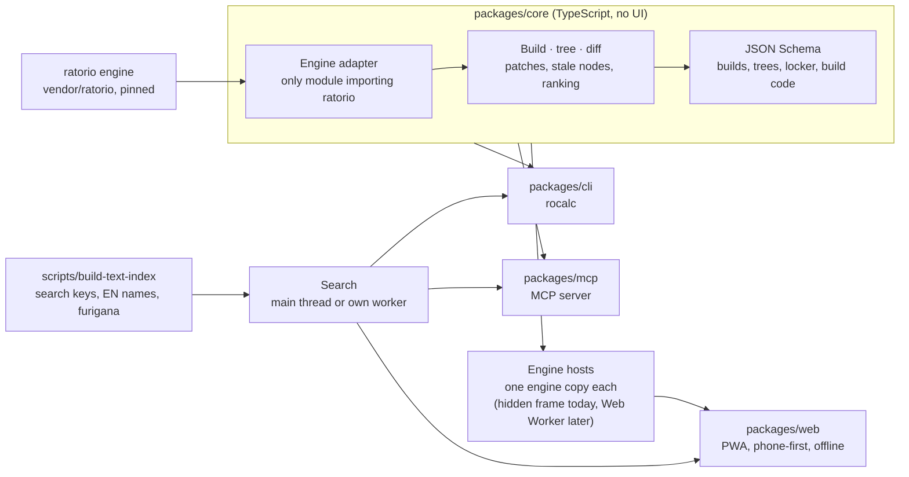
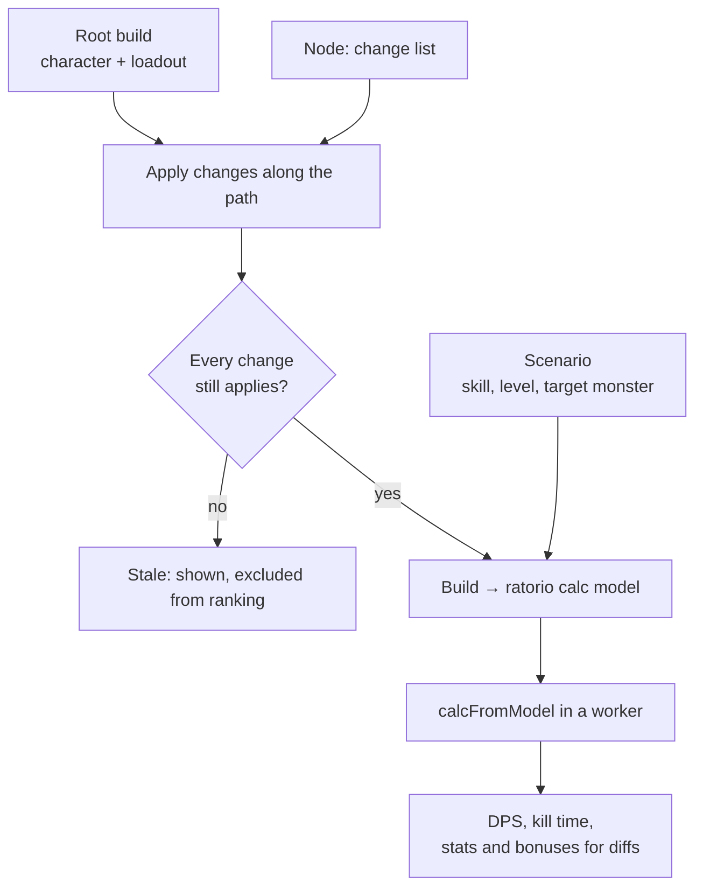

# Architecture

One TypeScript core holds all logic. The web UI, CLI and MCP server are thin front doors, and only the engine adapter touches the ratorio engine.

- **Why engine hosts in the browser:** the engine keeps module-level state and is not re-entrant, so each host holds its own engine copy and takes one build at a time through a calculator pool. A host is a hidden same-origin frame for now, because the engine needs a DOM while it loads and a Web Worker has none (`docs/upstream/dom-free-import.md`). Frames share the main thread, so branches do not recompute in parallel yet; outcomes are remembered per build, so an edit recalculates only the edited node and the nodes below it.
- **Why search is separate:** a tree recompute keeps the calculation workers busy; search on its own thread stays responsive while typing.
- **CLI and MCP** run in Node and call the core directly, behind the happy-dom globals shim.

## Tree evaluation

