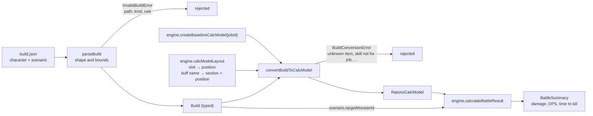
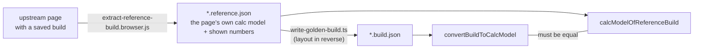

# From a build file to a result

A build file names things (slots, skill IDs, buff names). The engine wants positions in arrays. The converter is the only place that translates, and it asks the adapter where each named thing lives.

- **Two kinds of rejection.** `parseBuild` checks what can be known from the file alone. The converter checks what only the engine's data can answer, such as whether a job has a skill.
- **Why the layout comes from the adapter:** the positions are upstream constants, and only the adapter may read upstream. The converter never sees a raw position it did not get from the layout.

## How the golden builds prove it

The build file is derived from the reference once; the test then converts it forward again and requires the page's exact model, and the page's damage and DPS.
