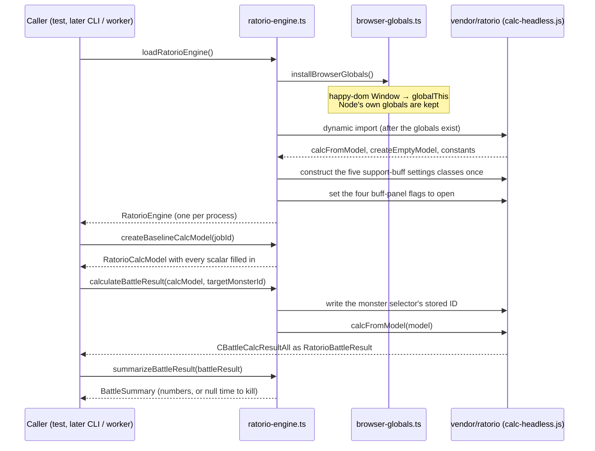

# Engine adapter

`packages/core/src/engine-adapter` is the only place that imports `vendor/ratorio`. Everything else sees `RatorioEngine`, `RatorioCalcModel`, `RatorioBattleResult` and `BattleSummary`.

- **Why the import is dynamic:** the engine reads `document` and friends while its modules load, so the globals must exist first. A static import would run before them.
- **Why one engine per process:** the engine keeps module-level state, and the module cache gives one copy anyway. The loader returns the same promise on every call.
- **Why the adapter reaches into engine state:** headless, the engine cannot pick a target monster, returns `NaN` until five settings classes have been constructed, and skips buff arrays while their panels count as closed. All three are worked around here and proposed upstream in `docs/upstream/`.
- **Why models start from a baseline:** upstream's empty model leaves its scalars undefined, and the engine then answers 0 or `NaN` without an error. The baseline is a naked level-1 character the engine can already calculate; callers only overwrite fields.
