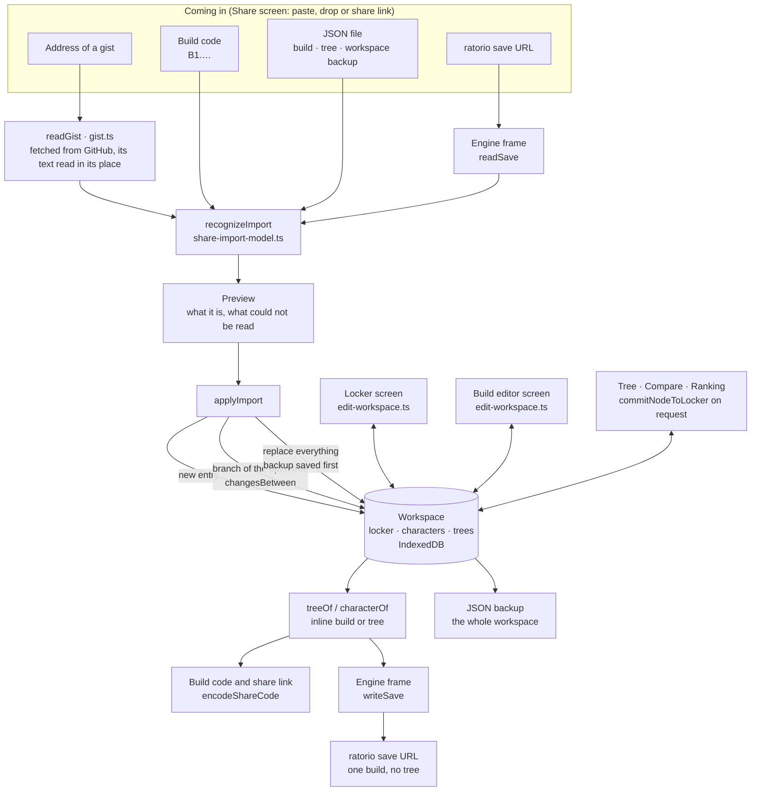

# Sharing and the workspace

What can come into the app, what can leave it, and which module does each step.

- **One recognizer for every way in.** Paste, file drop, file picker and a share link all hand a text to `recognizeImport`, which decides what it is and never changes anything. Only `applyImport` writes, and only after the preview.
- **A share link keeps the code in the URL fragment.** The fragment is not sent to the server that hosts the app; the app reads it once and removes it from the address.
- **ratorio saves go through the engine frame both ways**, because reading and writing them uses upstream's own save classes. Reading reports what it could not carry over (`notImported`); writing reports what the save has no place for (`notExported`).
- **A branch from an import** is the list of changes that turns the open tree's root into the imported character (`changesBetween`). Differences a change cannot express (job, levels, timed items, speed potion) are reported, not dropped silently.
- **Loadouts live in the workspace too.** A gear loadout points at locker pieces by slot, a stat loadout holds base and trait stats. Either can be put on a character or turned into the changes of a tree branch, which is how two loadouts are compared.
- **Locker edits reach everyone who uses the piece.** A piece is stored once; characters and tree nodes point at it by ID, so removing a piece that is still used is refused.
